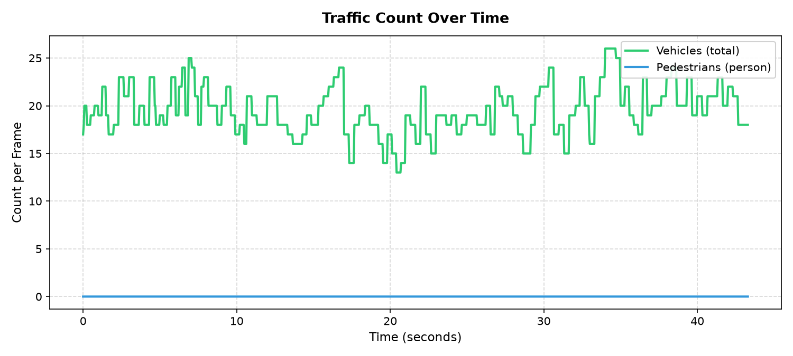

# EdgeVision Traffic Analysis Summary

## Executive Overview
- **Congestion Classification**: **High** (Average 19.5 vehicles/frame)
- **Vehicle-to-Pedestrian Ratio**: **19.49**
- **Planning Insight**: *"High vehicle saturation indicates corridor bottlenecks; consider optimizing signal phase splits and arterial progression."*

## Object Detection & Count Metrics

| Class | Peak Count | Average Count (per frame) |
|---|---|---|
| **Total Vehicles** | **26** | **19.49** |
| Person (Pedestrian) | 0 | 0.00 |
| Car | 20 | 11.92 |
| Truck | 3 | 0.59 |
| Bus | 14 | 6.97 |
| Motorcycle | 0 | 0.00 |
| Bicycle | 0 | 0.00 |

## Performance & Telemetry
- **Inference Runtime**: `pytorch-reference`
- **Frames**: 153 processed / 1040 total
- **Total Time**: 44.31 seconds
- **End-to-End Speed**: 23.5 FPS
- **Inference Latency (p50)**: 295.9 ms
- **Peak RSS Memory**: 437.7 MB

## Count Trends Over Time

