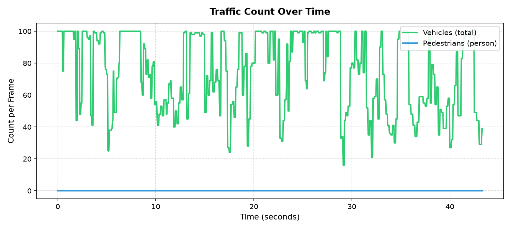

# EdgeVision Traffic Analysis Summary

## Executive Overview
- **Congestion Classification**: **High** (Average 74.8 vehicles/frame)
- **Vehicle-to-Pedestrian Ratio**: **74.83**
- **Planning Insight**: *"High vehicle saturation indicates corridor bottlenecks; consider optimizing signal phase splits and arterial progression."*

## Object Detection & Count Metrics

| Class | Peak Count | Average Count (per frame) |
|---|---|---|
| **Total Vehicles** | **100** | **74.83** |
| Person (Pedestrian) | 0 | 0.00 |
| Car | 100 | 74.63 |
| Truck | 2 | 0.06 |
| Bus | 2 | 0.15 |
| Motorcycle | 0 | 0.00 |
| Bicycle | 0 | 0.00 |

## Performance & Telemetry
- **Inference Runtime**: `executorch-int8`
- **Frames**: 304 processed / 1040 total
- **Total Time**: 38.47 seconds
- **End-to-End Speed**: 27.0 FPS
- **Inference Latency (p50)**: 122.6 ms
- **Peak RSS Memory**: 354.5 MB

## Count Trends Over Time

