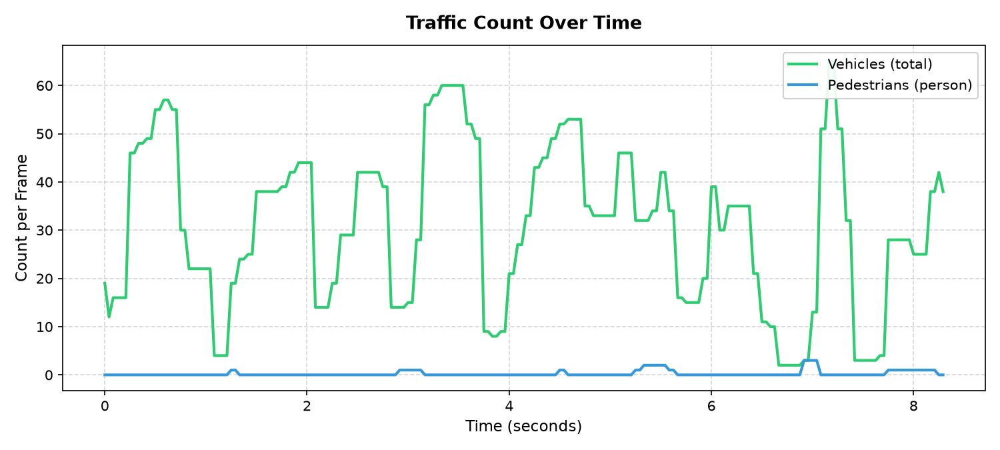

# EdgeVision Traffic Analysis Summary

## Executive Overview
- **Congestion Classification**: **High** (Average 30.8 vehicles/frame)
- **Vehicle-to-Pedestrian Ratio**: **123.14**
- **Planning Insight**: *"High vehicle saturation indicates corridor bottlenecks; consider optimizing signal phase splits and arterial progression."*

## Object Detection & Count Metrics

| Class | Peak Count | Average Count (per frame) |
|---|---|---|
| **Total Vehicles** | **65** | **30.79** |
| Person (Pedestrian) | 3 | 0.25 |
| Car | 65 | 30.64 |
| Truck | 1 | 0.08 |
| Bus | 0 | 0.00 |
| Motorcycle | 0 | 0.00 |
| Bicycle | 0 | 0.00 |

## Performance & Telemetry
- **Inference Runtime**: `executorch-int8`
- **Frames**: 100 processed / 200 total
- **Total Time**: 10.25 seconds
- **End-to-End Speed**: 19.5 FPS
- **Inference Latency (p50)**: 45.8 ms
- **Peak RSS Memory**: 350.7 MB

## Count Trends Over Time

